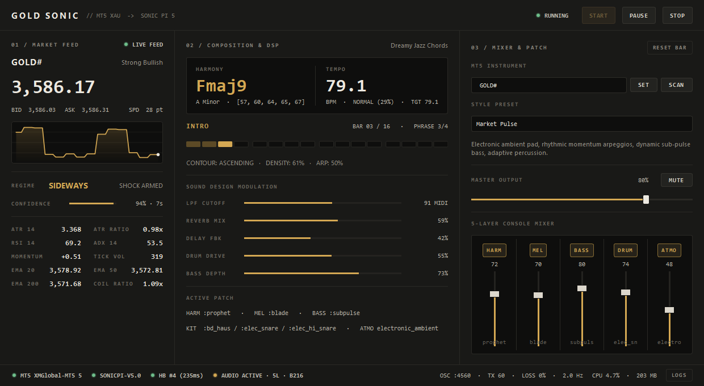

# GOLD SONIC — Real-Time Algorithmic Lo-fi Music Engine

**GOLD SONIC** transforms live Gold market telemetry from **MetaTrader 5** (`GOLD#`, `XAUUSD`, `XAUUSDm`, `GOLD`, etc.) into structured, music-theory-driven Lo-fi music in real time using **Python** as the Market & Musical Intelligence Engine and **Sonic Pi 5.0.0** (`SuperSonic`) as the 5-layer Audio Generation Engine over localhost **OSC/UDP**.



---

## Key Features

- **Real Live MT5 Market Data Pipeline**: Connects directly to MetaTrader 5 (`Bid/Ask`, `Last`, `Spread`, `Tick Volume`, `M1/M5/M15` OHLCV) with automatic symbol discovery, auto-reconnect, spread guards, staleness detection, and Safe Mode.
- **6-Regime Quantitative Market Intelligence**: Classifies live Gold behavior into `BULLISH`, `BEARISH`, `SIDEWAYS`, `HIGH_VOLATILITY`, `COMPRESSION`, and `MARKET_SHOCK` using ATR(14), EMA(20/50/200), EMA slope, RSI(14), ADX(14), realized volatility, and range compression with EMA smoothing, hysteresis, and shock cooldown.
- **Music-Theory Composition Engine**: Smooth voice-led jazz/lo-fi chord progressions locked to bar/phrase boundaries (never changing chords erratically on ticks), 4/8/16-bar arrangement structure (`Intro` → `Main Progression` → `Melody & Bass` → `Harmonic Variation` → `Transition`), slew-limited tempo (`68–100 BPM`), pentatonic/jazz melody motifs, and ATR-driven DSP modulation.
- **5-Layer Sonic Pi 5.0.0 Audio Engine**: Independent Harmony, Melody, Bass, Drums, and Atmosphere layers with preloaded samples, zero-clipping studio gain staging, Kick/Bass sidechain bloom, and two-way OSC heartbeat (`/gold/heartbeat` ↔ `/gold/pong`) proving real audio output.
- **Matte Hardware Console Dashboard (PySide6)**: Live OLED price sparkline, 16-step bar sequencer, hairline DSP meters, 5-channel vertical studio mixer, honest LED telemetry (`MT5`, `Sonic Pi`, `Heartbeat`, `Audio Engine Active`), and one-click Windows Desktop launcher.

---

## Architecture

```text
MT5 (GOLD# / XAUUSD)
  └─> core/mt5_connector.py      (Thread-safe MT5 API, symbol discovery, auto-reconnect)
  └─> core/market_data.py        (Tick validation, M1/M5/M15 candles, spread/staleness guards)
  └─> core/indicators.py         (ATR, EMA 20/50/200, RSI 14, ADX 14, Momentum, Realized Vol)
  └─> core/regime_detector.py    (6 Market Regimes, EMA smoothing, hysteresis, shock cooldown)
  └─> core/musical_engine.py     (Voice-led jazz chords, 4/8/16-bar arrangement, slew-limited BPM)
  └─> core/osc_client.py         (Validated/throttled UDP OSC TX :4560 + Pong RX :4561)
        └─> sonic_pi/gold_sonic.rb (+ harmony.rb, melody.rb, drums.rb, atmosphere.rb)
              └─> Real-Time 5-Layer Lo-fi Music
  └─> dashboard/main_window.py   (PySide6 Studio Console Dashboard)
```

---

## Requirements (Windows)

1. **Python 3.12** (recommended for official `MetaTrader5` Python wheels).
2. **MetaTrader 5** installed and logged into a broker account with a Gold symbol (`GOLD#`, `XAUUSD`, etc.).
3. **Sonic Pi 5.0.0** installed:
   ```powershell
   winget install SonicPi.SonicPi
   ```

---

## Installation & Quick Start

### 1. Clone & Set Up Virtual Environment
```powershell
git clone https://github.com/bonemive/GOLD_SONIC.git
cd GOLD_SONIC
py -3.12 -m venv .venv
.\.venv\Scripts\python.exe -m pip install -r requirements.txt
```

### 2. One-Click Desktop Launch (Recommended)
Create a Windows Desktop shortcut (`GOLD SONIC.lnk`) that silently boots Sonic Pi 5.0.0, connects to MT5, opens the Studio Console, and starts playing automatically:
```powershell
.\create_desktop_shortcut.ps1
```
Then simply double-click **GOLD SONIC** on your Desktop.

### 3. Manual Launch
- **Managed one-command launch (auto-boots Sonic Pi 5.0.0 if port `4560` is free):**
  ```powershell
  .\.venv\Scripts\python.exe main.py --autostart --manage-sonic-pi
  ```
- **Or use Sonic Pi GUI manually:**
  1. Open **Sonic Pi 5.0.0** (ensure **Preferences → IO → Enable OSC Server** is enabled on port `4560`).
  2. Run `run_file "/path/to/GOLD_SONIC/sonic_pi/gold_sonic.rb"` (`Alt+R`).
  3. Launch the Dashboard: `.\.venv\Scripts\python.exe main.py --autostart`
- **Headless console mode:**
  ```powershell
  .\.venv\Scripts\python.exe main.py --headless
  ```

---

## Musical Style Presets (`presets/`)

| Preset | ID | Character |
| :--- | :--- | :--- |
| **Rainy Night Lo-fi** | `rainy_night` | Warm `:rhodey` Rhodes, dusty `:sn_dub` drums, `:bnoise` rain & `:vinyl_hiss`, Minor 7 / Jazz voicings |
| **Golden Sunrise** | `golden_sunrise` | Sunlit `:piano` Major 7 / Major 9 chords, `:kalimba` melody, warm `:hollow` drone |
| **Midnight Jazz** | `midnight_jazz` | Extended `ii–V–I` `:fm` jazz chords, upright-style `:pluck` bass, swing brush kit, vinyl texture |
| **Market Pulse** | `market_pulse` | `:prophet` & `:blade` electronic ambient, `:subpulse` bass, rhythmic momentum arpeggios |

---

## OSC Protocol Schema (`127.0.0.1:4560` TX / `127.0.0.1:4561` RX)

| Address | Arguments |
| :--- | :--- |
| `/gold/market` | `[symbol, price, atr_m1, rsi14, spread_points, quality]` |
| `/gold/mood` | `[style_id, mood, musical_key, section, bar_in_cycle, swing, atmosphere_mode]` |
| `/gold/volatility` | `[volatility_norm, filter_cutoff, reverb_amount, delay_feedback, drum_intensity, bass_energy]` |
| `/gold/momentum` | `[momentum_norm, melody_direction, note_density, arpeggio_intensity, octave_variation]` |
| `/gold/regime` | `[regime, safe_mode, paused, muted]` |
| `/gold/bpm` | `[bpm]` |
| `/gold/harmony` | `[chord_name, bass_note, n1, n2, n3, n4, n5]` |
| `/gold/melody` | `[m0, m1, m2, m3, m4, m5, m6, m7]` |
| `/gold/layers` | `[g_harm, g_mel, g_bass, g_drum, g_atmo, s_harm, s_mel, s_bass, s_atmo, kick, snare, hat, rim, accent]` |
| `/gold/shock` | `[intensity, direction, spike_atr]` |
| `/gold/heartbeat` | `[seq, feedback_port, safe_mode]` |
| `/gold/pong` *(Sonic Pi → Python)* | `[seq, sonic_pi_version, audio_active, active_layers, bars_played]` |

---

## Running Tests

```powershell
.\.venv\Scripts\python.exe -m pytest -v
```

---

## License

[MIT](LICENSE)
